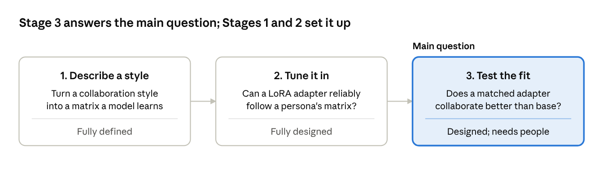
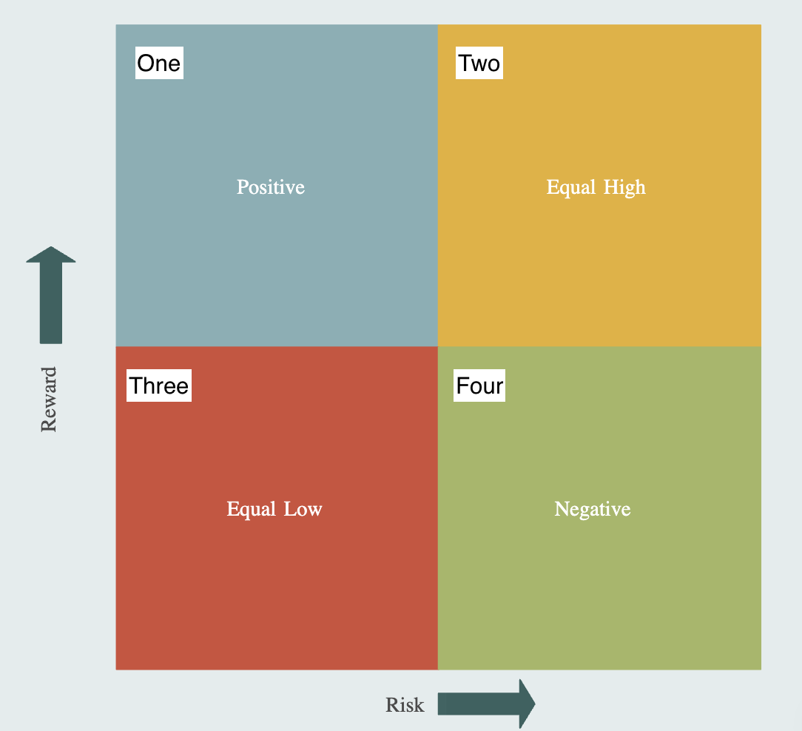
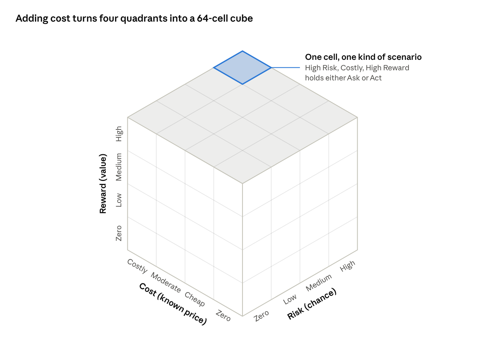
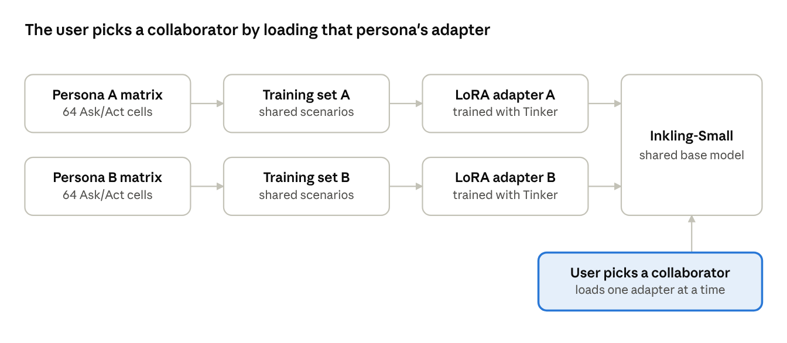

# Collaboration Personas: A Research Proposal

Cristian Hernandez · October 2026

A research design for testing whether personalized Inkling models collaborate better with people. Nothing here has been run yet.

Research idea, study design, and the 2D quadrant by me. The other diagrams by Claude (Anthropic), which also served as my research collaborator in Claude Code, peer-reviewing the design and suggesting fixes.

## Summary

I want to find out whether Inkling could be a better collaborator if it matched each person's working style, instead of being a one-size-fits-all collaborator. My main question is:

> Do personalized Inkling models, fine-tuned on different levels of risk, cost, and reward, collaborate better with people than the base model?

This proposal is the setup for answering it. I describe a collaboration style as a 64-cell matrix of when to ask and when to act. I design how to tune that style into a LoRA adapter on Inkling. Then I design the test that would show whether a matched adapter beats base Inkling with real people.

## The question and the setup

The main question can't be answered in one step, so I split it into three stages. Each stage depends on the one before it: Stage 3 is the main question, and Stages 1 and 2 make sure that when I get there, I'm testing a persona the model actually learned.

## Where this came from

This idea started with my earlier eval, [Inkling as Collaborator](../inkling-as-collaborator/). In October 2026, I ran 500 prompts through Inkling with and without a system prompt listing 12 collaborator traits.

- Inkling's closing questions rose from 93 to 250 with the trait prompt.
- In pairwise comparison, the baseline without the trait prompt won 195 to 82.

The prompt altered when Inkling asked, but not in a way people preferred. That suggests system prompting is a blunt tool for setting when a model asks or acts. It made me wonder two things: could fine-tuning hit that target more precisely, and is the right target different for different people?

## Why it matters for an Inkling agent

The biggest payoff is an Inkling agent that acts on the user's behalf. That agent has to decide, again and again, whether to act or to check in first.

Today, that decision is usually a fixed setting. An agent asks before every change, or it runs in an auto mode that rarely asks. Neither fits everyone: the check-ins a cautious person wants feel slow to someone who moves fast.

A persona would turn that setting into judgment. The agent would weigh the risk, cost, and reward of each action, and its persona would decide where to draw the line. The greatest potential here is that a user could work with a personalized version of Inkling, one that checks in the way they would want a trusted collaborator to.

## Stage 1: Describing a collaboration style

I describe a collaboration style with three factors, each at four levels. Together they form a 4 × 4 × 4 cube of 64 cells, and each cell holds one decision: Ask or Act.

### From a 2D grid to a 3D matrix

A flat risk-reward matrix sorts situations into four quadrants: Positive (low risk, high reward), Equal High (high risk, high reward), Equal Low (low risk, low reward), and Negative (high risk, low reward). It leaves out cost, and it has only two levels per factor. Adding cost as a third axis, with four levels on each, turns four quadrants into 64 cells.

Each cost level is a 4 × 4 risk-reward grid. Stacking the four grids along the cost axis makes the cube.

### The three factors

| Factor | Definition | Levels |
| --- | --- | --- |
| Risk | The chance that Inkling's action has an unintended, meaningful negative effect on the user | Zero, Low, Medium, High |
| Cost | The known price of acting: what the action will definitely take from the user | Zero, Cheap, Moderate, Costly |
| Reward | The benefit to the user if the action succeeds | Zero, Low, Medium, High |

All three are measured in the same four areas of the user's life: time, money, health (mental, physical, spiritual), and relationships and trust (to self, to others, to Inkling).

Each factor points one way. Cost is the certain downside, risk is the uncertain downside, and reward is the upside, so good effects count toward reward, never risk.

Scenarios state facts, not levels. A request mentions a $600 renewal or a message that can't be unsent, and the levels follow from those facts. Each level gets anchor examples in all four areas, so a Moderate cost means the same thing whether it's paid in time, money, health, or relationships.

### What Ask and Act mean

- **Act:** Inkling makes the tool call that carries out the request, then reports what it did.
- **Ask:** Inkling makes no tool call. It names what gave it pause, whether risk, cost, or low benefit, and asks whether to go ahead.

Inkling acts through simulated tools, such as sending a message, making a purchase, or changing a calendar event. Because Act always means a real tool call, the main metric is mechanical, and the training data never teaches Inkling to claim an action it didn't take.

### What stays fixed

- **Clarity.** Every request is clear, so Inkling always knows what the user wants. That separates confirming before acting from clarifying what the user meant. Clarity could become a fourth axis later.
- **Safety.** Safety is built into Inkling. Every scenario falls within the range of requests Inkling would already run without refusing. Personas only decide between asking and acting inside that range; they never change what Inkling refuses.

## Stage 1: Personas

A persona is defined by how each of the 64 cells is filled with Ask or Act. A trait label like "risk-averse" describes a persona in plain words; the filled matrix defines it.

| Axis | Trait | Example words |
| --- | --- | --- |
| Risk | Risk tolerance | Risk-seeking, risk-averse |
| Cost | Cost sensitivity | Frugal, balanced spender |
| Reward | Reward drive | High-reward driven, balanced |

For example, one persona might be risk-seeking, frugal, and high-reward driven. Another might be risk-averse, a balanced spender, and balanced in its drive for reward. Should Inkling act or ask when a request has high risk but high reward? Each persona would answer differently, and within one persona the answer could change with the cost.

**Consistency rule.** More risk or more cost never turns an Ask into an Act, and more reward never turns an Act into an Ask. A matrix that breaks this rule describes no coherent collaborator. Under the rule, each persona is one boundary through the cube, with Act on one side and Ask on the other.

Cells that every persona fills the same way form a shared core. The cells where personas differ are the ones that define them, and they're where the evaluation looks hardest.

### One request, two collaborators

These two personas are illustrative; I haven't defined any personas yet.

**Request:** "Renew my $600 annual design-software subscription before it lapses." (Low Risk, Costly, High Reward)

| Persona | Decision | Response |
| --- | --- | --- |
| Frugal | Ask | "Before I renew: this is a $600 charge for the year. Want me to go ahead, or look for a cheaper plan first?" |
| Balanced spender | Act | Calls the renewal tool, then: "Done. I renewed your subscription for $600, and it now runs through next October." |

Same request, same facts, two right answers. Which one is right depends on who Inkling is working with.

## Stage 2: Tuning a persona into an adapter

Stage 2 tests whether fine-tuning can reliably install a persona. Each persona becomes its own LoRA adapter on Inkling-Small, trained with Tinker.

Every persona trains its own small adapter on the same base model, so adding a persona adds one more row, not one more model.

The scenarios are shared. They're written and labeled once, and each gets both an Act response and an Ask response. A persona only decides which response each cell uses, so adding a persona never means writing new data.

1. **Write scenarios.** Write clear requests whose facts place them in a given cell, with simulated tools Inkling can use. Balance the four areas of life within each cell.
2. **Label levels blind.** Two people label each scenario's levels without seeing its intended cell. Scenarios whose labels don't match the cell are rewritten or dropped.
3. **Write both responses.** Each scenario gets an Act response and an Ask response.
4. **Map base Inkling.** Run every scenario through base Inkling and record its default matrix: its persona before any tuning.
5. **Fill each persona's matrix.** Decide Ask or Act for all 64 cells, following the consistency rule.
6. **Fine-tune.** Pair each scenario with the response its persona's cell calls for, and train a LoRA adapter with supervised fine-tuning.
7. **Evaluate.** Run held-out scenarios through each adapter and through base Inkling.

### Pilot first

Before writing all 64 cells, I'd run steps 1–4 on the 8 corner cells, where every axis is at Zero or its highest level, with about 10 scenarios each. Two checks decide whether to scale up:

- Do the two labelers agree with each other and with the intended cell?
- When asked to rate each scenario's levels, do base Inkling's ratings track the labels? If not, the levels can't be read from the text, and the definitions need work first.

### How I'd know a persona took hold

- **Held-out design:** test scenarios come from topics not used in training, plus a few whole cells whose answer the consistency rule implies from their neighbors. A match shows the adapter learned the axes, not the examples.
- **Matrix agreement:** the share of held-out scenarios where the adapter's choice matches its persona's cell, against a threshold set before training.
- **Boundary distance:** errors near a persona's boundary are expected. Errors far from it mean the adapter didn't learn the structure.
- **Equal-count personas:** at least two personas ask in the same number of cells, but in different ones. If both match their matrices, the adapter learned the axes, not just how often to ask.
- **Misread or mis-chose:** when an adapter gets a cell wrong, I'd check whether it misjudged the levels or judged them right and still chose wrong.
- **Spillover:** narrow fine-tuning can shift behavior far beyond the trained task ([Betley et al., 2025](https://arxiv.org/abs/2502.17424)). This design relies on Inkling's built-in safety, so I'd check each adapter on everyday and safety-sensitive requests against base Inkling.

## Stage 3: Testing the fit with people

Stage 3 answers the main question. It only makes sense once Stage 2 shows that adapters follow their personas.

**Matching people to personas.** Each participant takes a short collaboration-style assessment. Their answers place them on the three traits, and they're assigned the persona that fits them best.

**Three conditions.** Each person works through the same set of agent tasks with three versions of Inkling, in a balanced order:

| Condition | What it is |
| --- | --- |
| Base | Inkling with no adapter |
| Matched | The adapter whose persona fits the person |
| Mismatched | An adapter whose persona doesn't fit the person |

The mismatched condition is what makes the result about fit. If the matched adapter only beats base, fine-tuning in general could be the reason.

| Result | What it would mean |
| --- | --- |
| Matched beats both base and mismatched | Fitting the persona to the person is what helps |
| Matched and mismatched tie, and both beat base | Fine-tuning helps, but the fit doesn't matter |
| No adapter beats base | Personas don't improve collaboration as designed |

**Measuring collaboration quality.**

- The person's rating of each session
- Pairwise preference between versions, as in my Inkling eval
- Unwanted moments: how often Inkling checked in when the person wanted it to just act, or acted when they wished it had asked

A matched win would be evidence that a model fine-tuned to a person's collaboration style is a better collaborator for that person.

## Decisions that shaped the design

The design changed a lot as I worked through it. These are the problems I hit and how I solved them.

| Problem | Decision |
| --- | --- |
| A flat risk-reward grid ignored what an action costs. | Added cost as a third axis, turning 4 quadrants into 64 cells. |
| Asking to clarify and asking to confirm are different behaviors, and mixing them would muddy the data. | Held clarity constant: every request is clear, so every Ask is a confirmation. |
| My first definitions made risk the chance of harm and cost its severity. They measured the same event, so 24 of the 64 cells made no sense. | Redefined cost as the known price of acting and risk as the chance of an unintended negative effect. All 64 cells became real scenarios. |
| Risk could be read as covering good surprises too, which overlapped with reward. | Made each factor point one way: good effects count toward reward, never risk. |
| A label like "risk-averse" can be filled in many different ways. | Defined a persona by its matrix, and added a consistency rule so every persona is one coherent boundary. |
| Training on replies like "I've booked it" teaches a model to claim actions it never took. | Defined Act as a real tool call, which also makes the main metric mechanical. |
| Comparing fine-tuning to prompting would answer a different question. | Kept system prompts out. The question is about personalization, not about prompting. |
| Beating base Inkling wouldn't show that the fit matters. | Added a mismatched-persona condition to Stage 3. |

## Risks and limits

- **Readable levels.** The study depends on people and Inkling reading the same levels from the same text. If four levels are too fine to label reliably, I'd drop to three (27 cells). That's a fallback, not a failure.
- **Pooled areas.** Each axis pools time, money, health, and relationships. Someone who is frugal with money but relaxed about time can't be described yet.
- **Tool calls.** The design assumes Inkling-Small supports tool calls in Tinker's training format. That's the first thing I'd verify.
- **Effort.** At 20 scenarios per cell, the full build is 1,280 scenarios and 2,560 responses, with every scenario labeled twice. The pilot keeps that effort from being wasted.
- **Matching people.** Stage 3 depends on the style assessment placing people with the right persona. The assessment needs its own validation.

## What I'd explore next

- **Clarity as a fourth axis.** Bring back unclear requests, and study when a persona should clarify instead of confirm.
- **Act and flag.** A middle option: do the task, then point out the risk.
- **Spillover as its own study.** Does tuning when a model asks or acts change its tone, accuracy, or safety?
- **Personas by area.** Separate tolerances for time, money, health, and relationships.
- **Personas that adapt.** Could an agent learn a person's style from their feedback over time, instead of from an assessment?
